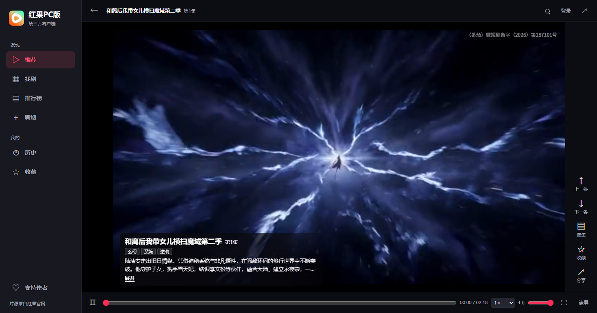

# 红果PC版

红果PC版是一个 Windows 64 位第三方短剧播放器，片源来自红果官网。

[下载 Windows 64 位最新版](https://github.com/yehuili1/hongguo-pc/releases/latest)

1. 打开发布页，在 **Assets** 里下载 Windows x64 的 ZIP 压缩包。
2. 右键压缩包，选择「全部解压缩」。
3. 打开解压后的文件夹，双击 `红果PC版.exe`。

## 观看短剧

- 打开「推荐」直接播放短剧，用鼠标滚轮或上下方向键切换。
- 在「找剧」按剧名搜索，也可以浏览「排行榜」和「新剧」。
- 播放时，左下角显示剧名、标签、当前集数和可用的剧情简介。支持调节音量、倍速和全屏。
- 收藏想看的剧，或从「历史」继续上次的观看。

可播放的剧集和集数取决于红果官网当时开放的片源。播放页提示登录时，可以按页面提示操作。

## 支持作者

在左侧底部打开「支持作者」，可以扫码或打开收银台。打赏完全自愿，金额由你决定。

